# Hi, I'm Louzhiyuan 👋

Click the Clear Light terminal to launch my personal website

> I moved from Product Operation into AI product management.
> I build AI products.
> I also create tools and reusable skills that turn complex technical context into clearer product decisions.
> AI Product — turning complex technology into products users can actually use.
> and following the real-world adoption of Agents and LLMs.

🌐 [个人网站](https://lzyhappylife.github.io/personal-website/) · ✉️ [邮箱](mailto:454035647@qq.com)
📕 [小红书](https://www.xiaohongshu.com/user/profile/61c00b8f000000001000c0a3)
---

## ⭐ Featured projects

> Products and tools built through an engineering and product lens.

### 🧰 [personal-website](https://github.com/lzyhappylife/personal-website)

纯静态响应式个人主页，支持深色模式，托管在 GitHub Pages。

### 🎯 [小致客服 · Chatflow 评测与优化](https://udify.app/chat/0HxeLfESFNkN6Tz9)

围绕《五杀峡谷》客服场景搭建可计分的 25 题评测闭环，定位意图分流、规则召回、实时查询和拒答边界问题，将最终回归通过率从 13/25（52%）提升到 25/25（100%）。

### 🤝 [Learning Partner · AI 学习陪伴助手](https://udify.app/chat/PocOUbKPp6ocYKi8)

基于 Dify Cloud 和课程知识库，支持面试辅导、随堂测验、自动判分、思维导图、联网搜索和笔记整理，形成学习、练习、复盘和知识库迭代闭环。

### 🧪 LoRA 微调与 Dify 部署实践

以 Qwen2.5-0.5B 为例，走通云端实例部署、LLaMA Factory 数据格式转换、训练参数配置、API 暴露和 Dify 对话 Agent 测试，记录从模型训练到应用验证的完整路径。

---

## ✍️ Writing

> I write about AI products through an engineering and product lens.

- [给 Agent 少喂一点：上下文信号密度比 token 数量更重要](https://mp.weixin.qq.com/s/Ulw0d2oQXb9uSWP5XLEGGw)
- [从围堵豆包到封杀Muse，大厂筑起的生态墙又能撑多久？](https://mp.weixin.qq.com/s/P4Me3Hu9mKnNVwfrSn-p2w)
- [从发现错误到持续改进，企业 AI 幻觉治理的完整闭环](https://mp.weixin.qq.com/s/KqAvvznbZT4MpgFBnR2Qsg)

---

## About

- AI Builder|PM，
- Focus on Agent Engineering & AI Product
- Think → Act → Review → Consolidate, and repeat

---
